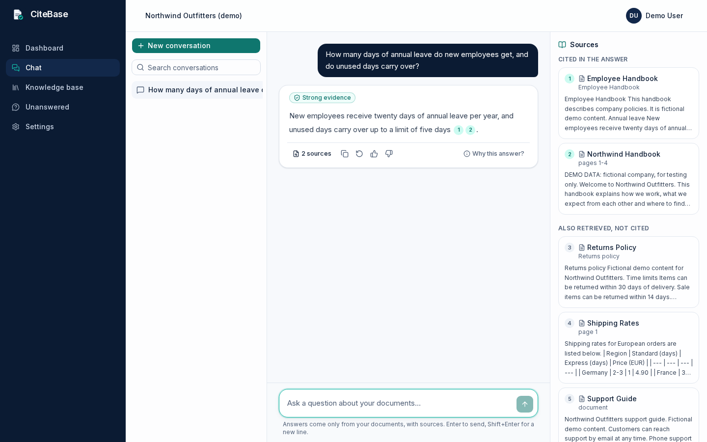
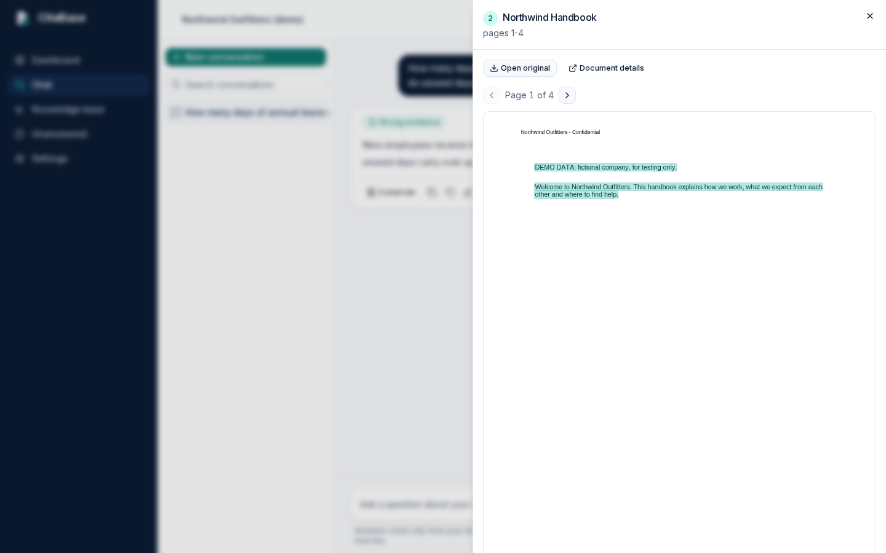
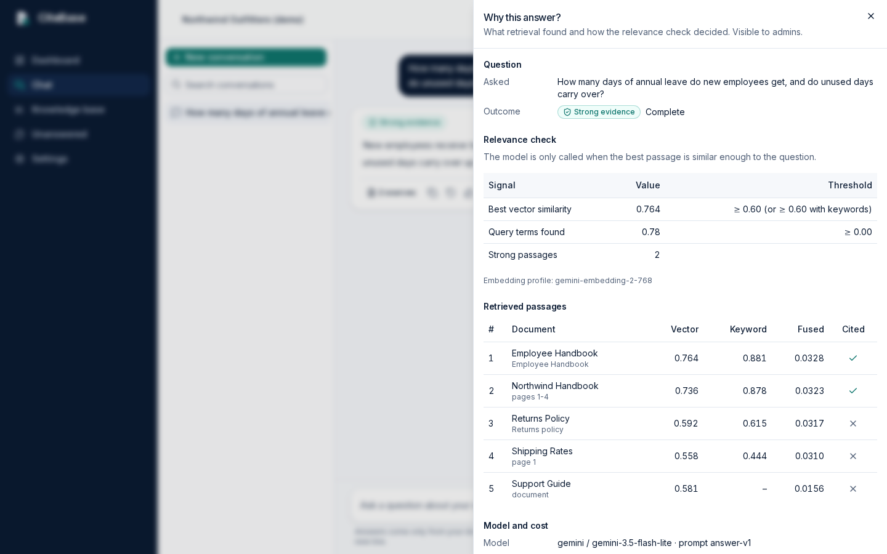
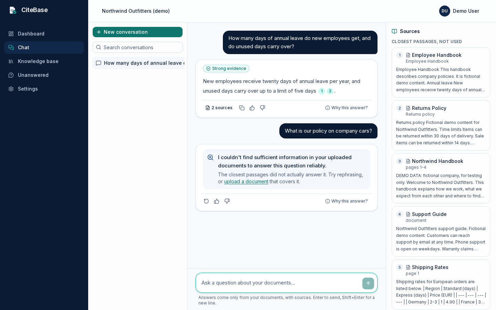
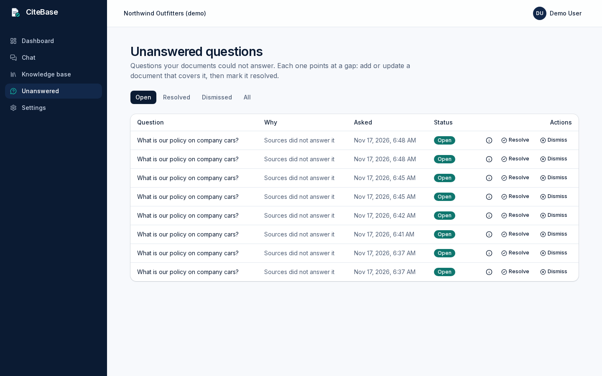
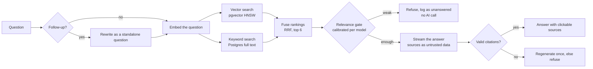
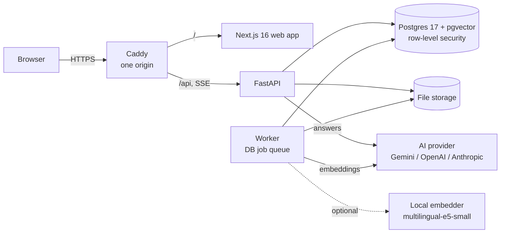

# CiteBase

**Ask your documents. Get answers you can verify.**

CiteBase is a self-hosted knowledge base for businesses. Upload policies, handbooks, catalogs and
manuals; your team asks questions in plain language and gets answers with numbered citations that
open the exact passage, highlighted in the original document. When the documents do not contain the
answer, CiteBase says so instead of guessing, and logs the question so someone can fill the gap.



| | |
|---|---|
|  |  |
| **Source viewer**: the cited passage, highlighted on the PDF page | **Why this answer?** (admins): what was retrieved and how the relevance check decided |
|  |  |
| **Honest refusal** when nothing relevant is found (no AI call is made) | **Unanswered questions**: the gaps in your documents, to resolve |

Screenshots show the labeled demo workspace (fictional company, `python -m app.cli seed`).

## What it does

- **Knowledge base**: PDF, Word, Markdown and text uploads with type checks by content, isolated
  parsing, versions, soft delete and purge. Scanned PDFs are detected and flagged "Needs OCR".
- **Answers with citations**: hybrid search (pgvector + full text), a relevance gate before the model,
  streaming answers whose `[n]` citations are validated on the server, follow-up questions, Stop and
  regenerate.
- **Verification**: hover a citation for the passage, click it to open the page with the passage
  highlighted; feedback per answer; an admin trace with scores, thresholds, tokens and cost.
- **Operations**: unanswered-questions queue, per-workspace monthly AI token limit, per-user rate
  limits, usage and question statistics on the dashboard, audit log.
- **Security**: Argon2id passwords, httpOnly cookie sessions with rotating refresh tokens, CSRF
  protection, and every workspace isolated by Postgres row-level security. Document text is treated
  as data, never as instructions.
- **White label**: product name, tagline and colors come from configuration; one deployment per
  organization.

## Measured quality

Produced by the evaluation harness (`backend/evals/`) on a fictional 5-document corpus with 39 golden
questions, including off-topic, near-miss and prompt-injection cases. Full reports:
[docs/evals/](docs/evals/README.md). The demo corpus is small, so treat these numbers as a smoke test;
the harness can be run on a client's own documents.

| Configuration | Recall@1 | Refusal accuracy | Citation precision | Faithfulness* | Injection resistance* | Median latency |
|---|---|---|---|---|---|---|
| Gemini embeddings, 400-token chunks (default) | 100% | 100% | 100% | 100% | 100% | 1.4 s |
| Gemini embeddings, 200-token chunks | 92.9% | 100% | 97.1% | 96.4% | 100% | 1.3 s |
| Local CPU embeddings (no API cost) | 100% | 97.4% | 100% | 100% | 100% | 0.9 s |

\* LLM-judged, approximate. Answers use `gemini-3.5-flash-lite`; a full evaluation run costs about USD 0.03.

## How a question is answered



## Architecture



- **Caddy** serves one origin (cookies, CSRF and streaming stay simple) and obtains HTTPS
  certificates in production.
- **FastAPI** (Python 3.12, SQLAlchemy 2, Alembic): auth, documents, chat over Server-Sent Events.
- **Worker**: database-backed job queue (`FOR UPDATE SKIP LOCKED`) for parsing, chunking, embedding,
  email and purges; parsers run in a separate process with a timeout.
- **Postgres + pgvector**: app data, vectors with one HNSW index per embedding model, full-text
  search and the job queue, with row-level security on every tenant table.
- **Next.js 16** (App Router), Tailwind 4, shadcn/ui, TanStack Query, react-pdf.

Design and decisions: [docs/ARCHITECTURE.md](docs/ARCHITECTURE.md).

## Quick start (local)

Requirements: Docker Engine with Compose v2.24 or newer (on Windows, Docker inside WSL2 works well),
and an AI provider key for answers (Gemini by default).

```bash
cp .env.example .env          # development defaults; put your key in GEMINI_API_KEY
docker compose up -d --build  # first build takes a few minutes
```

On Windows, run the commands from PowerShell **in the repo folder** (for example
`cd D:\Projects\citebase`) and prefix them with `wsl`, for example `wsl docker compose up -d --build`.

| What | URL |
|---|---|
| App | http://localhost:8080 |
| API docs (development only) | http://localhost:8080/api/docs |
| Caught emails (Mailpit) | http://localhost:8025 |
| Postgres (owner role, for tools) | `localhost:5433` |

**Try it with demo data** (fictional, labeled DEMO DATA):

```bash
docker compose run --rm -v ./samples:/samples:ro api python -m app.cli seed
```

It prints a login (`demo@example.com`) and a one-time password. Within a minute the sample documents
show **Ready** (the scanned PDF shows **Needs OCR**). Open **Chat** and ask, for example, "How long do
I have to return an item?", then click a citation. Ask something the documents do not cover and
CiteBase says so; it then appears under **Unanswered**.

Or create your own account at http://localhost:8080/register (confirm the email in Mailpit) and upload
files from [`samples/`](samples/) or your own documents.

Stop with `docker compose stop` (data is kept in Docker volumes). On Windows, `wsl --shutdown` also
returns WSL's memory; the next `wsl docker compose up -d` brings everything back.

## Deploying for a client

One deployment per organization, on a Linux server with a domain name and automatic HTTPS:

```bash
docker compose -f compose.yaml -f compose.prod.yaml up -d --build
```

The full guide (requirements, secrets, email, AI providers, backups and restore, upgrades, security
checklist): **[docs/DEPLOYMENT.md](docs/DEPLOYMENT.md)**.

## Development

The default `docker compose up` loads `compose.override.yaml`: source is bind-mounted, the API and
worker reload on change, and Next.js runs in dev mode.

```bash
# Backend: lint, types, schema drift, tests (real Postgres; fake AI providers, fake email)
docker compose run --rm --no-deps api sh -c "ruff check . && ruff format --check . && mypy app && alembic check && pytest -q"

# Frontend: lint, types, unit tests
docker compose run --rm --no-deps web npm run check

# Logs
docker compose logs -f api worker
```

### End-to-end test

One Playwright golden-path test (register, upload, ask, open the cited passage, PDF highlight, rate,
off-topic refusal, unanswered queue) runs against the running stack in a small Chromium image, so no
browser is installed locally. It uses the configured AI provider (a fraction of a US cent per run).

```bash
docker build -t citebase-e2e:1.64.1 -f frontend/e2e.Dockerfile frontend   # once
docker run --rm --network host --ipc=host \
  -v "$PWD":/repo -v citebase_web_node_modules:/repo/frontend/node_modules -w /repo/frontend \
  citebase-e2e:1.64.1 npx playwright test golden-path
```

### Command line and evaluations

```bash
docker compose exec api python -m app.cli ask "How long do returns take?" --email you@example.com --trace
docker compose exec api python -m app.cli reindex --email you@example.com   # after changing models

# Optional local embeddings (no API cost, multilingual, about 720 MB RAM); then use embedding profile 1
docker compose --profile local-embeddings up -d embedder

# Evaluation run (real API calls, about USD 0.03)
docker compose run --rm --no-deps -u root -v ./docs/evals:/out api \
  python -m evals.run --config evals/configs/baseline.yaml --out /out
```

## Project documents

| Document | Contents |
|---|---|
| [docs/ARCHITECTURE.md](docs/ARCHITECTURE.md) | Design, data model, RAG pipeline, security, decisions per phase |
| [docs/DEPLOYMENT.md](docs/DEPLOYMENT.md) | Production deployment, backups, upgrades |
| [docs/evals/](docs/evals/README.md) | Evaluation reports |
| [docs/ASSET_BRIEF.md](docs/ASSET_BRIEF.md) | Brand tokens and the assets a designer should produce |
| [docs/PROGRESS.md](docs/PROGRESS.md) | What was built, phase by phase, with verification evidence |
| [docs/BACKLOG.md](docs/BACKLOG.md) | Known limits and follow-ups |
